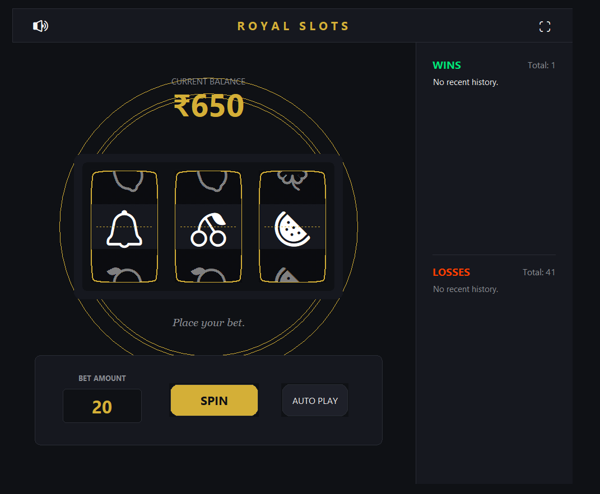

# Slot Machine: Royal Slots V3.2


<p align="center">
  
</p>

A feature-rich, premium slot machine game built with Python and Tkinter. This latest version introduces persistent save states, auto-spin mechanics, a detailed history log, and a Gaussian distribution system for a fairer, more thrilling gameplay loop.

## What's New in V3.2

### The "Fair Play" Gaussian RNG System 
Say goodbye to extreme streaks of bad luck! We've replaced the old flat RNG with a **Normal (Gaussian) Distribution System** using the Box-Muller transform. 
* Outcomes naturally cluster around mid-tier rolls.
* Extreme outliers (like hitting the lowest payout or the mega jackpot) are mathematically rarer, making those big jackpot wins feel like a genuine, momentous achievement!

### Persistent Sessions
Never lose your progress again. The new **Persistence System** automatically records your balance, total wins, and total losses to a local `save_game.json` file. Your casino empire waits exactly where you left it.

### Quality of Life Additions
* **Auto-Spin**: Sit back and let the machine do the work with the new toggleable "AUTO" system. 
* **Audio Control**: Instantly mute or unmute the sound effects using the interactive toggle directly on the top navigation bar. 
* **Fullscreen Support**: Immerse yourself in the action with the new dedicated fullscreen toggle (or by pressing F11).

## Premium Visual & UI Overhaul

* **Royal Gold & Obsidian Aesthetic**: We've stripped away the chaotic neon effects in favor of a sleek, luxurious layout featuring deep obsidian backgrounds, frosted glass panels, and sharp gold typography.
* **Structured Architecture**: The interface has been rebuilt into a professional layout with a dedicated top navigation bar, a central slot stage, and a unified bottom control deck.
* **Curved Cylinder Reels**: Custom scrolling mechanics enhanced with a stippled gradient illusion to simulate curved metal slot cylinders.
* **Live History Sidebar**: Keep track of your hot streaks. The expanded History Dashboard is now flawlessly integrated into a unified right sidebar, logging every win and loss during your session in real time.
* **Luxurious Animations**: Experience a slow, breathing golden radial glow behind the machine, smooth hover states on the buttons, and a sophisticated scale-bump font effect whenever you hit a big win.

---

## Setup Instructions

### Prerequisites
- Python 3.x
- `pygame` library (for sound effects)

### Installation
1. Clone the repository:
   ```bash
   git clone https://github.com/toxicbishop/Slot-Machine.git
   ```
2. Navigate to the latest version folder:
   ```bash
   cd "Slot-Machine/Slot-machine version 3.2"
   ```
3. Install dependencies:
   ```bash
   pip install -r ../requirements.txt
   ```
4. Run the game:
   ```bash
   python Slot_Machine_v3.2.py
   ```

## How to Play
1. Start with your current saved balance (or a fresh ₹20,000).
2. Enter your bet amount.
3. Click **SPIN** and wait for the symbols to line up.
4. Winning combinations require 3 of the same symbol across the reels:
   - Cherry: 2x Bet
   - Watermelon: 4x Bet
   - Lemon: 6x Bet
   - Bell: 10x Bet
   - Clover: 15x Bet
   - Star: 25x Bet
   - Diamond: 50x Bet

## License
Distributed under the MIT License. See [LICENSE](LICENSE) for more information.
